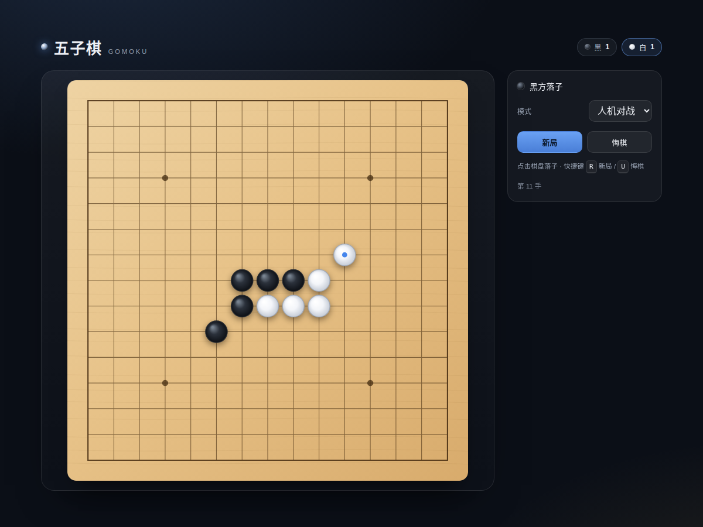
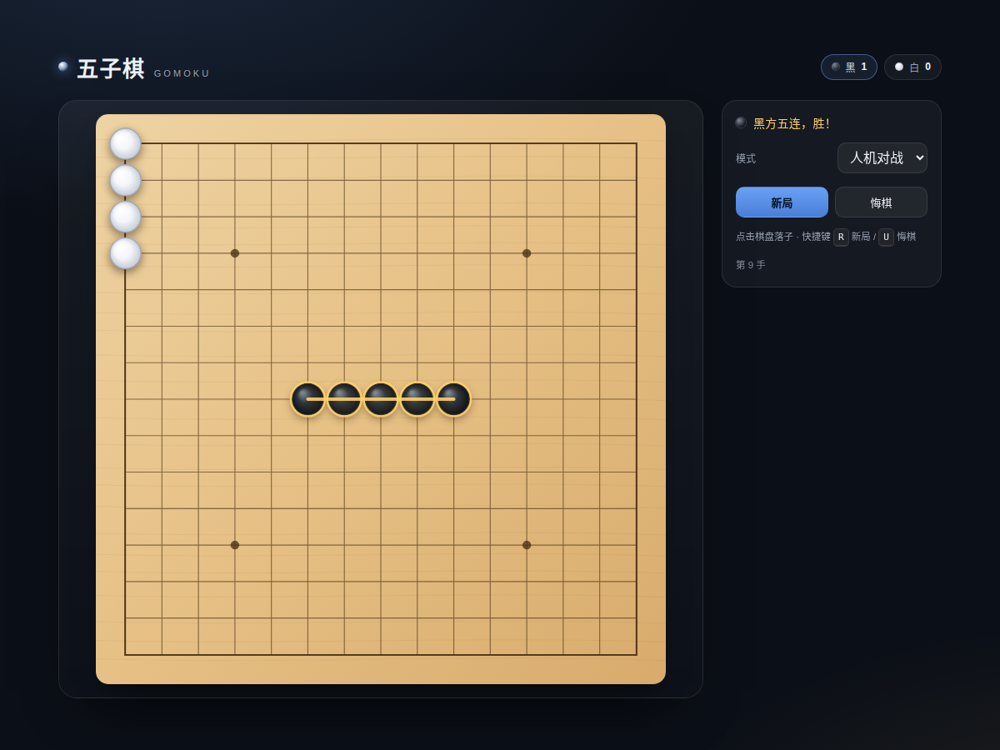

# 五子棋 · Gomoku

单文件实现的五子棋，15×15 棋盘、三档 AI、悔棋、胜负高亮。**零依赖、零构建**——把 `gomoku.html` 下载下来用浏览器打开就能玩。



## 快速开始

```bash
git clone <this-repo> && cd gomoku
# 方式一：直接打开
open gomoku.html            # macOS
xdg-open gomoku.html        # Linux
start gomoku.html           # Windows

# 方式二：起了本地静态服务再访问
python3 -m http.server 8000 # 然后打开 http://127.0.0.1:8000/gomoku.html
```

没有构建步骤，`file://` 协议下也能完整运行。

## 玩法

- 黑先，横/竖/斜任意方向**先连成 5 颗**（更多也算）即胜；棋盘下满判平局
- 点击**交叉点**落子，半个格子内自动吸附
- 面板：模式（人机 / 双人）、难度（简单 / 普通 / 困难）、新局、悔棋
- 悔棋：人机模式一次退回「你 + AI」两手，双人模式退回一手
- 快捷键：`R` 新局、`U` 悔棋
- 最后落子处有标记点（黑棋金点 / 白棋蓝点），空点悬停显示半透明预落子
- 五连时棋子描金环 + 金色连线脉冲，顶部计分牌累计胜场
- 窄屏自动切换为上下布局



## AI 思路

1. 只搜索已有棋子周围 2 格内的空点，空棋盘抢天元
2. 每个候选点做 4 个方向、9 格窗口的模式打分：连五 / 活四 / 冲四 / 活三 / 眠三 / 活二……
3. 按「攻击分 + 防守分加权」排序：**先看自己能否成五 → 再看对手能否成五 → 再按威胁排序**
4. 「困难」额外多看一层：把排名前 6 的走法各假设一遍，估算对手最佳回应的价值，挑「我威胁大、对手反击小」的一步，因此不容易走进双三 / 活四陷阱
5. 「简单」加入较大随机噪声会漏防；「普通」只做一层评估

## 测试

用 Playwright 驱动系统 Chrome 做无头验证，三组脚本共 13 项断言：

```bash
node test.cjs    # 规则 / AI / 悔棋 / 布局 / 控制台报错
node test2.cjs   # 真实鼠标点击落点 + 画布像素（黑白子、空点）
node test3.cjs   # 胜利高亮连线颜色、状态文案、计分
```

覆盖点：

- 横向 / 斜向五连判胜，终局后禁止继续落子
- AI 应手、堵活四、抓自己的连五、应对活三
- 悔棋在人机模式回退一整手
- 桌面 1200px 与 420px 窄屏都不溢出，棋盘始终正方形
- 真实点击精确落在目标交叉点（`(7,7)`、`(8,8)`）
- 像素级确认：黑子 luma 64、白子 221、空点木色 162、胜利连线琥珀色 `(249,204,100)`

## 实现要点

- 全部逻辑在一个 IIFE 里，无模块、无框架，`file://` 可用
- Canvas 按 `devicePixelRatio` 缩放，窗口变化时重算格距
- 胜负动画用单个 `requestAnimationFrame` 脉冲，结束/重开时正确取消，不会泄漏
- `window.__gomoku` 暴露状态与算法函数，方便脚本化测试

## License

尚未添加许可证。如需开源授权（如 MIT），可以补一个 `LICENSE` 文件。
